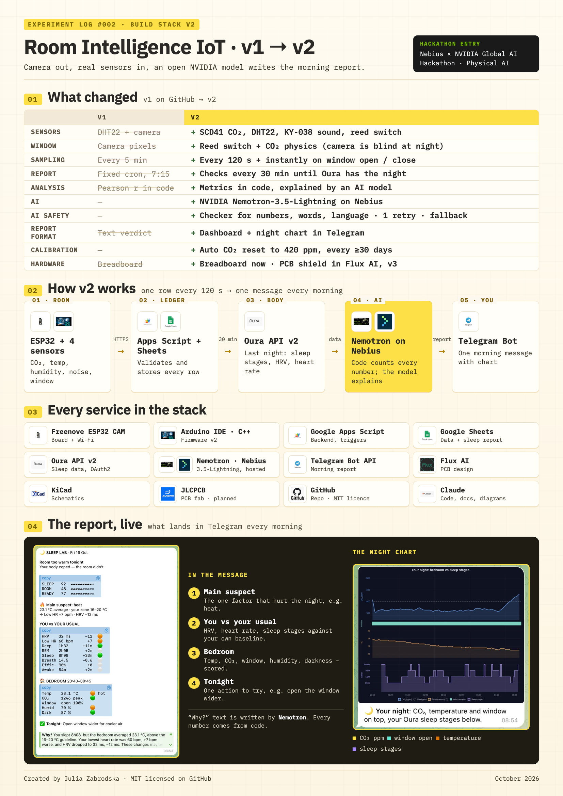
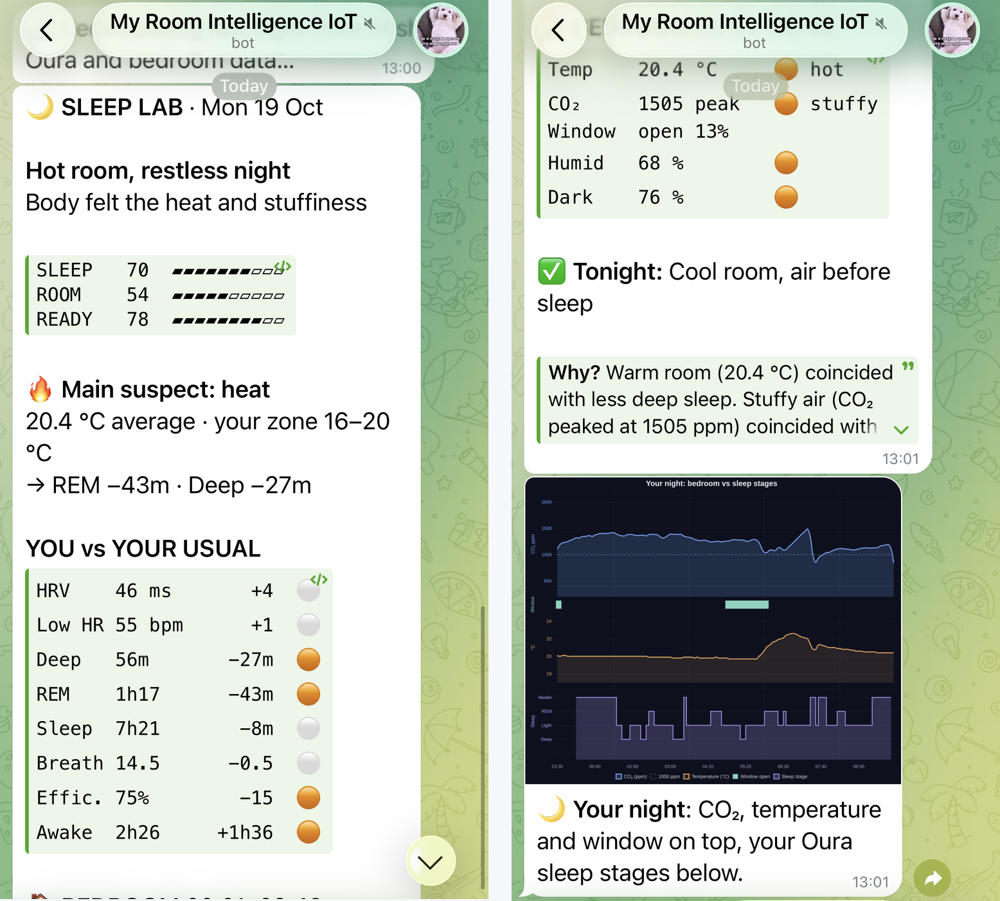
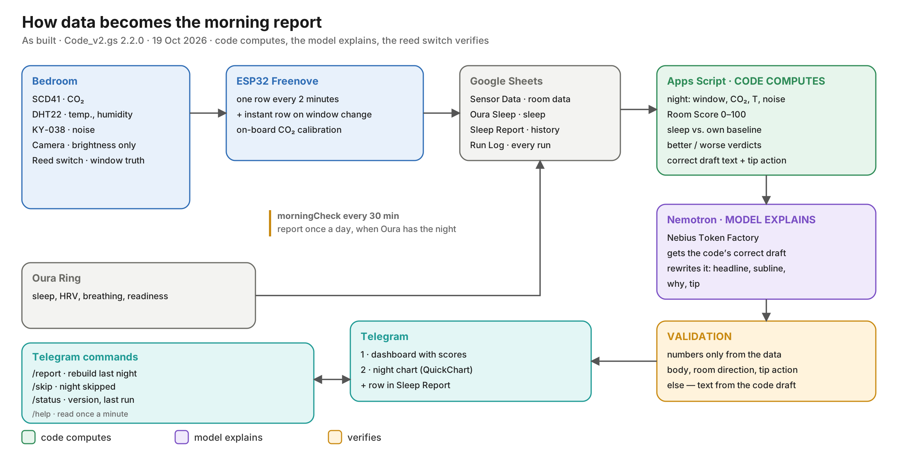
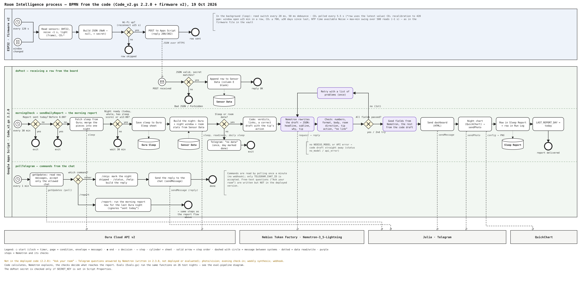
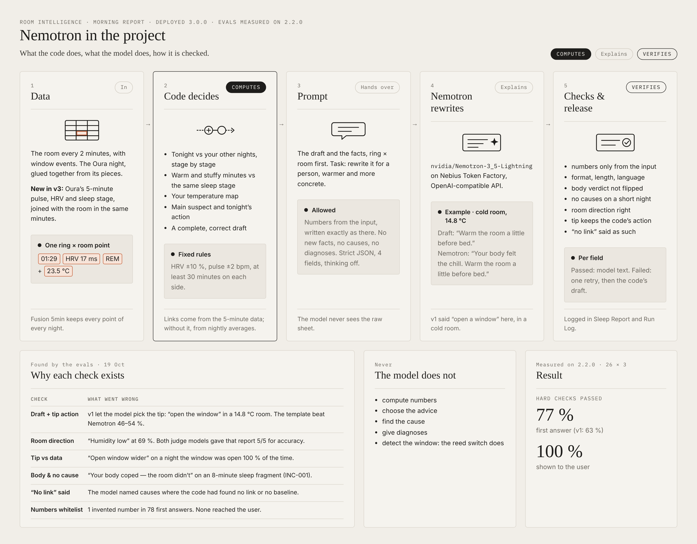
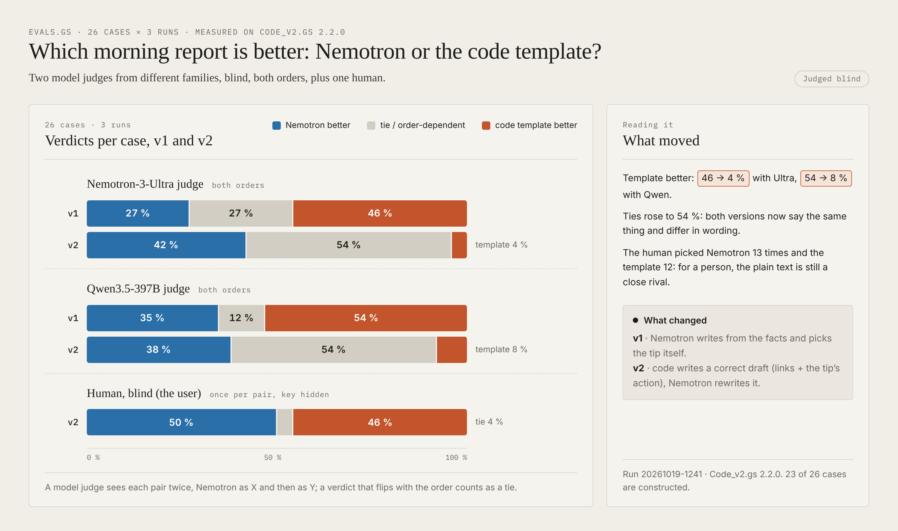
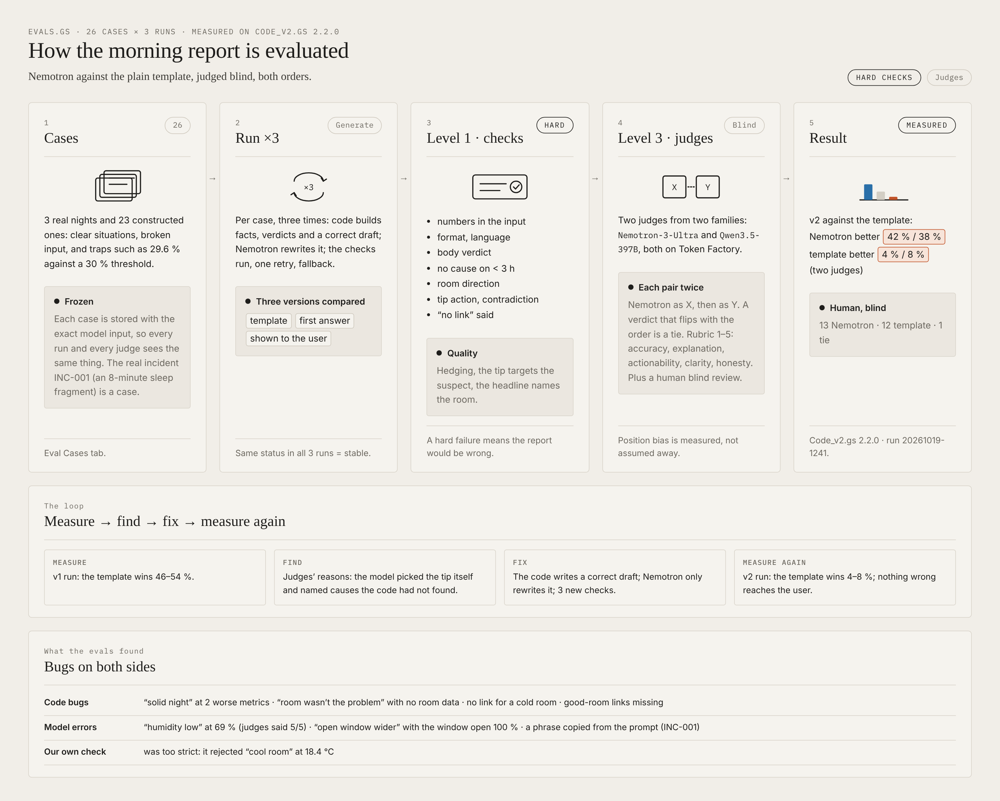
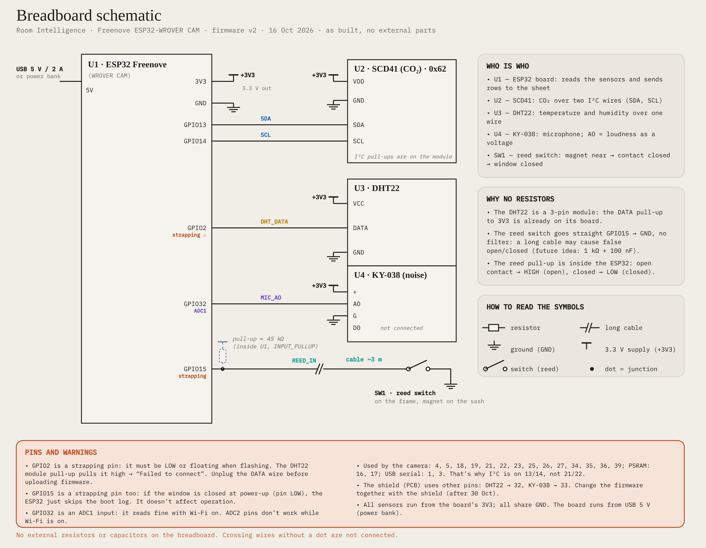

# 🌙 Room Intelligence — why did I sleep badly?

**An ESP32 bedroom sensor + Oura ring + NVIDIA Nemotron on Nebius Token Factory.
Code calculates every number. The model explains them. The reed switch keeps everyone honest.**

[](LICENSE)
· Built for the **Nebius × NVIDIA Global AI Hackathon** — track: **Physical AI**

> 🎬 **Demo video (3 min):** ⏳ in editing — the link goes here before submission
> 🖼️ **Morning report in Telegram:** [see a real one below](#what-arrives-in-the-morning)

---



<sub>The Telegram card on this poster is an early report (16 Oct, before the evals). Two of its lines are exactly what the evals later caught:
*"Your body coped"* while HRV was 12 ms below usual, and *"Open window wider"* on a night the window was open 100 % of the time.
Both are now hard checks — see [Evaluation](#evaluation-we-measured-it-it-lost-we-fixed-it--method). Window state comes from the reed switch.</sub>

---

## The problem

A sleep tracker tells you *what* happened: short deep sleep, low HRV, restless night.
It can't tell you *why* — because it has no idea what your bedroom was doing.
Was it too warm? Was the air stale because the window was shut? Was it noisy?

Room Intelligence closes that gap. A small sensor box on the bedside table records the room all night.
In the morning, the system lines up the room with your Oura night and sends a short, honest explanation to Telegram:
what the room did, how your body responded, and **one thing to try tonight**.

It is an **n-of-1 experiment on one person**, not a medical device. One night is a hint, not proof — and the report says so.

---

## What arrives in the morning



<sub>A real report for the night ending Mon 19 Oct, requested with `/report`. **Left:** headline, the three scores, the main suspect chosen by code, and the night against my own usual. **Right:** bedroom numbers, one thing to try tonight, the "why" (Telegram folds the rest), and the night chart — CO₂, temperature and window on top, Oura sleep stages below.</sub>

---

## How it works



1. **ESP32 in the bedroom** reads CO₂, temperature, humidity, noise, light and a **reed switch on the window**.
   It sends a row every 2 minutes, plus an instant row whenever the window opens or closes.
2. **Google Apps Script** (`doPost`) appends each row to a Google Sheet.
3. **Every 30 minutes** after 6:00, `morningCheck` asks Oura whether last night is ready
   (or it's past 12:00). Then `sendDailyReport` runs once per day.
4. **Code computes everything:** the night window (from Oura bedtime), room statistics for that window,
   comparisons with your own baseline, verdicts (better / worse / normal), the main suspect, and fallback texts.
5. The code writes a **correct draft** of the four fields (`headline`, `subline`, `why`, `tip`): the links it found and the action for tonight.
   **NVIDIA Nemotron** (via **Nebius Token Factory**) rewrites the draft for a person, adding numbers from the facts.
6. **Code checks every field** before it reaches you (see below). Bad fields are replaced by the code's own text.
7. **Telegram** receives an HTML dashboard and a night chart (CO₂, temperature, window + Oura sleep stages).
   A row is written to the `Sleep Report` sheet for history.

**Full process (BPMN 2.0, drawn from the code — Code_v2.gs 2.2.0 + firmware v2):**

[](docs/diagrams/room-intelligence-report-process_v4_en.png)

<sub>Click to open full size. Lanes: ESP32 firmware · `doPost` (receiving rows) · `morningCheck → sendDailyReport` (the morning report) · `pollTelegram` (commands).
Function-by-function map of the code: [docs/HOW_THE_CODE_WORKS.md](docs/HOW_THE_CODE_WORKS.md).</sub>

---

## How we use NVIDIA Nemotron and Nebius Token Factory

| | |
|---|---|
| **Model** | `nvidia/Nemotron-3_5-Lightning` (open model, served by Nebius Token Factory) |
| **API** | OpenAI-compatible `/chat/completions` on Token Factory |
| **Mode** | reasoning off: `chat_template_kwargs: { enable_thinking: false }` — short, fast, no `<think>` |
| **Task** | rewrite the code's correct draft for a person: warmer, clearer, with concrete numbers — strict JSON `headline`, `subline`, `why`, `tip` |
| **Where in the code** | `apps-script/Code_v2.gs` → `nebiusChat_()`, `dashTexts_()` |



### Why the model can't make things up

The model never sees raw data and never does arithmetic. It gets a short fact sheet that the code already computed,
including **verdicts that it must not contradict**. Then every answer goes through checks:

- **Number whitelist** — every number in `why` must appear in the input, written exactly the same way.
- **No digits** in `headline`, `subline` and `tip`.
- **Length limits** per field.
- **Language** — English only (no Cyrillic), no `<think>` leftovers, no internal words like "code", "facts", "verdicts".
- **No contradiction** — the headline can't call the night fine when two or more sleep metrics were worse, and can't get
  the room direction wrong ("humidity low" at 69 %, "chilly" at 23 °C).
- **No causes on thin data** — no "caused" or "due to" ever, and no room→body links when under 3 hours of sleep were recorded.
- **Valid JSON** — otherwise the model is asked again.

If a check fails, the model gets **one retry** with the list of problems.
After that, **good fields from Nemotron are kept and bad ones are replaced by the code's fallback text**.
If the model is unavailable, the report still goes out — fully from code.
Every report records its AI status (`ok`, `partial`, `rejected`, `fallback`, `api_error`, `no_model`) in the `Sleep Report` sheet.

### Evaluation: we measured it, it lost, we fixed it · [method](docs/EVALS.md)



26 cases (3 real nights, 10 clear situations, 8 broken inputs, 5 traps) × 3 runs. Two judge models from different families,
both on Nebius Token Factory — `nvidia/Nemotron-3-Ultra-550b-a55b` and `Qwen/Qwen3.5-397B-A17B` — compare Nemotron's report
with the code-only template, blind, each pair twice (Nemotron as X, then as Y). Rubric: accuracy, explanation, actionability, clarity, honesty.



**v1 — Nemotron wrote from the facts and picked the tip itself.** The template won (46 % and 54 % of cases).
The judges' reasons showed why: the model defaulted to *"open the window"* — even in a 14.8 °C room — and named causes
where the code had found no link. Our own prompt had primed it with example tips.

**v2 — the code writes a correct draft (links and the tip's action), Nemotron rewrites it.**

| | v1 | v2 |
|---|---|---|
| Nemotron-3-Ultra judge: Nemotron / template better | 27 % / 46 % | **42 % / 4 %** |
| Qwen3.5-397B judge: Nemotron / template better | 35 % / 54 % | **38 % / 8 %** |
| Nemotron's first answer passes all hard checks | 63 % | **77 %** |
| Errors that reached the user | 0 | **0** |

In v2 Nemotron scores above the template on accuracy, explanation, clarity and honesty with both judges
(explanation 4.65 vs 4.21 and 4.83 vs 4.37); actionability is level with one judge (4.50 vs 4.52).
The judges agree with each other on 11 of 12 cases with a stable verdict.

**Honest caveats.** Ties grew to 54 %: both versions now say the same thing and differ in wording, so position bias decides more often —
judge self-consistency fell from 81 % to 60 %, which is why every pair is judged in both orders.
Only 3 of 26 cases are real nights so far.

**Human blind review (me, 26 pairs, v2): Nemotron 13 · template 12 · tie 1.** For a person, v2 and the template read almost
the same — v2 keeps the template's meaning by design, so the extra value of the rewrite in a four-line card is small; when the
template was preferred, Nemotron's version was on average longer. So the morning card proves Nemotron can be made **safe**
(as accurate as code, judged slightly better); the next step puts it where a template can't exist at all: answering free questions
about your own nights in Telegram.

**What the evals found along the way** — each became a fix and a test case:

| Finding | Whose error | Fix |
|---|---|---|
| "Your body coped" on an 8-minute night with 5 worse metrics (real report, [INC-001](docs/EVALS.md)) | Nemotron | body-verdict check |
| "Humidity low" at 69 % — **both judges scored it 5/5 for accuracy** | Nemotron (and the judges) | room-direction check |
| "Open window wider" when it was open all night | Nemotron | tip vs window check |
| "Open the window" in a cold room; causes where the code found none | Nemotron (prompt design) | v2: the code chooses the action and the links |
| "Solid night" with two worse metrics; "the room wasn't the problem" with no room data | code template | thresholds and wording fixed |
| No room→sleep link for a cold room, none for a good room | code verdicts | links added |
| Our check rejected "cool room" at 18.4 °C (true) | our check | only strong words count |

---

## Hardware



| Part | What it measures | Pins (ESP32) |
|---|---|---|
| Freenove ESP32-WROVER CAM | brain + Wi-Fi; the camera is used **only as a light meter** | — |
| Sensirion SCD41 | CO₂ (ppm) | SDA **GPIO13**, SCL **GPIO14**, 3V3, GND |
| DHT22 (3-pin module) | temperature, humidity | DATA **GPIO2**, 3V3, GND |
| KY-038 | noise (analog) | AO **GPIO32** (ADC1), D0 not used |
| Reed switch + magnet | window open / closed — **ground truth** | **GPIO15** → GND (internal pull-up), ~3 m cable |
| USB 5 V / 2 A or power bank | power | USB |

⚠️ **Before flashing, unplug the DHT22 DATA wire.** GPIO2 is a strapping pin and the module's pull-up blocks upload ("Failed to connect").
I²C is on 13/14 because the camera uses 21/22.

Wiring diagram: [`docs/diagrams/wiring-sensors-esp32_en.png`](docs/diagrams/wiring-sensors-esp32_en.png)

---

## Setup

You need: the hardware above, an Oura ring, a Google account, a Telegram account and a Nebius Token Factory API key.

### 1. Google Sheet + Apps Script

1. Create a Google Sheet and name the first tab **Sensor Data**. Open **Extensions → Apps Script**.
2. Paste `apps-script/Code_v2.gs`. For evaluation, add a second script file `Evals` with `apps-script/Evals.gs`.
3. Add the **OAuth2 for Apps Script** library (needed for Oura): Libraries → `+` → script ID
   `1B7FSrk5Zi6L1rSxxTDgDEUsPzlukDsi4KGuTMorsTQHhGBzBkMun4iDF` → Add.
4. **Project Settings → Script Properties** — add:

   | Property | Value |
   |---|---|
   | `OURA_CLIENT_ID`, `OURA_CLIENT_SECRET` | from your Oura developer app |
   | `TELEGRAM_BOT_TOKEN` | from @BotFather |
   | `TELEGRAM_CHAT_ID` | your chat ID |
   | `NEBIUS_API_KEY` | Nebius Token Factory key |
   | `NEBIUS_MODEL` | `nvidia/Nemotron-3_5-Lightning` |
   | `SECRET_KEY` | any long random string — **must match** `SHARED_SECRET` in the firmware |

5. Run `setupSensorHeaders()` once.
6. **Deploy → New deployment → Web app** (execute as you, access: anyone). Copy the web app URL.
7. Run `authorize()` and open the logged link to connect Oura.
8. Run `setupTrigger()` (30-minute `morningCheck`) and `setupCommands()` (Telegram commands).
9. Run `checkSetup()`, then test: `testTelegram()`, `testNemotron()`, `sendDashboardDemo()`.

**Telegram commands:** `/report` recalculates and resends today's report · `/skip` marks a missed night
(no report or reminders today) · `/status` shows what data is available · `/help`.

### 2. Firmware (ESP32)

1. Arduino IDE + **esp32** board package. Board: *ESP32 Wrover Module*, PSRAM **enabled**.
2. Install the libraries this firmware actually includes: **DHT sensor library** by Adafruit (+ its **Adafruit Unified Sensor** dependency) and **Sensirion I2C SCD4x**. `WiFi.h`, `HTTPClient.h`, `Wire.h`, `Preferences.h`, `time.h` and `esp_camera.h` ship with the ESP32 board package — nothing to add for those.
3. Copy `esp32/secrets.h.example` → `esp32/room_intelligence_v2/secrets.h` and fill in
   `WIFI_SSID`, `WIFI_PASSWORD`, `SHEETS_URL` (the web app URL) and `SHARED_SECRET`.
4. **Unplug DHT22 DATA**, upload, plug it back.
5. Open Serial Monitor at **115200**: you should see a sensor line and `Sheets: 200` or `302` every 2 minutes,
   and an instant row when you move the magnet away from the reed switch.

---

## Data

**Sensor Data** (one row every 2 min + one per window event):
`Date · Temp °C · Humidity % · Brightness · (legacy, empty) · Sound · CO₂ ppm · Window Contact (open/closed)`

**Oura Sleep** — one row per night from the Oura API.
**Sleep Report** — one row per morning: room stats, Oura metrics, AI status and the explanation text.
**Run Log** — one row per report and per command: Oura pieces, sleep minutes, night window, AI status and problems.

---

## Privacy and safety

- **No photos leave the device.** The camera is only read as a brightness number.
- All data lives in **your own** Google Sheet. The only external calls are Oura, Nebius Token Factory, QuickChart (chart image) and Telegram.
- Secrets live in Script Properties and in a git-ignored `secrets.h` — never in the repository.
- This is **not medical advice**. Single-night results are presented as hints ("may", "is consistent with"), never as causes.

## Known limitations

- **One person, few nights.** Correlations need weeks of data. The Oura API also limits unapproved apps to 10 users.
- **Light** is the camera's frame brightness with auto-exposure — a rough indicator, not lux.
- **Noise** is the signal swing of a cheap analog microphone; Wi-Fi adds interference. Treat it as relative.
- **CO₂ recalibration** assumes outdoor air ≈ 420 ppm when the window has been open ≥ 15 min; in a city it can be higher.
- Broken sleep arrives from Oura in pieces; they are merged into one night. Under 3 hours of sleep, the report does not link the room to the body.

---

## What changed during the submission period

✅ **Done so far:**
- Connected **NVIDIA Nemotron via Nebius Token Factory** for the morning explanation, with per-field validation, one retry and code fallback.
- Replaced camera-based window detection (it fails in the dark) with a **reed switch as ground truth**.
- Added **CO₂ (SCD41)** and **noise (KY-038)**; firmware v2: rows every 2 minutes + instant rows on window events, on-board CO₂ recalibration.
- New **Telegram dashboard** with a night chart (room + Oura sleep stages).
- **Evaluation harness** (`Evals.gs`): 26 cases × 3 runs, two judge models from different families, both orders, human blind review.
- **v1 → v2 of the Nemotron step**, driven by the evals: the code writes a correct draft, Nemotron rewrites it; new hard checks for the body verdict, room direction, tip action and "no link".
- **Broken-sleep nights** (real incident, 19 Oct): pieces of one night are merged; the early report waits for Oura's sleep score; "no data" is sent once.
- **Telegram commands** `/report`, `/skip`, `/status`, `/help` and a `Run Log` tab.

🔄 **In progress:**
- **"Ask your room"** — Nemotron as a Telegram chat bot answering free questions about your own nights (code selects and computes, the model explains, the answer is checked). The code is in `Code_v2.gs` 2.3.0 but is **not deployed and not evaluated yet**; the numbers in this README were measured on version 2.2.0.
- Demo video.


## Feedback on Nebius Token Factory and NVIDIA models

⏳ To be added before the submission deadline.

## Repository structure

```
apps-script/   Code_v2.gs (sensor intake, Oura, report, Telegram commands), Evals.gs
esp32/         room_intelligence_v2/ (firmware), secrets.h.example
docs/          EVALS.md, HOW_THE_CODE_WORKS.md, TROUBLESHOOTING.md, diagrams/, eval-results/, screenshots/
```

## Roadmap

- Make Nemotron a chat bot for the room ("Ask your room"), with its own evals
- Hot-room advice: prefer "turn the radiator down" when the window was closed
- Two weeks of nights → first real room ↔ sleep relationships
- PCB shield and enclosure (pins will change: see `docs/`)
- Battery + deep sleep
- Small pilot with 5–10 Oura users

## License

[MIT](LICENSE) © 2026 Julia Zabrodska
